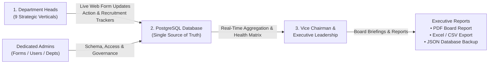
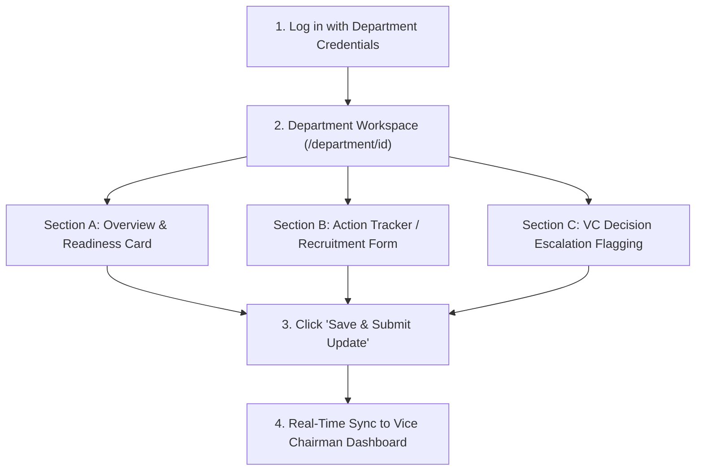
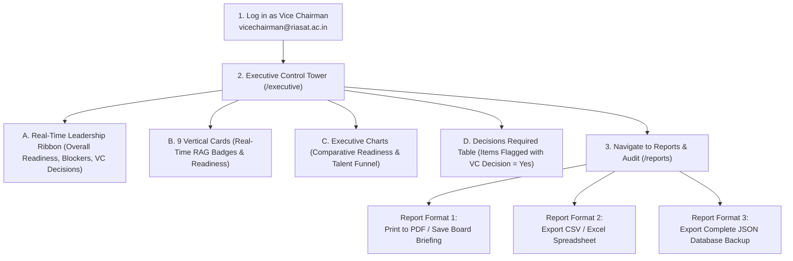

# RIASAT Executive Control Tower: Complete Operations Manual (A to Z)

**Ramaiah Institute for Advanced Skills & Technology (RIASAT)**  
*Academic & Commissioning Cycle 2026–2027 • Executive Governance Standard*

---


---

## 1. Executive Summary & Architecture

The **RIASAT Executive Control Tower** is the centralized mission-control platform designed for the leadership of the Ramaiah Institute for Advanced Skills & Technology. It provides end-to-end operational visibility across all **9 Strategic Verticals**, synchronizing real-time department filings into an overarching executive command dashboard for the **Vice Chairman and Executive Leadership**.

### Key Architectural Highlights
- **Single Source of Truth**: Powered by a unified PostgreSQL relational database, replacing fragmented Excel files and disconnected spreadsheets.
- **Role-Based Workflows**: Department Heads manage their operational trackers; dedicated administrators govern form configurations, user provisioning, and departmental structures; the Vice Chairman and Leadership enjoy complete overarching visibility and decision approval tools.
- **Bi-Directional Governance**: Ground-level departmental milestones flow upward into executive analytics, while Vice Chairman escalations and decisions flow directly downward into vertical action items.



---

## 2. Live Access Links & Credentials Directory

### Application Access Endpoints
- **Local Network Address**: [http://localhost:3000](http://localhost:3000)
- **Public Tunnel Address (Secure Cloudflare SSL)**: [https://sticks-slots-controversy-selection.trycloudflare.com](https://sticks-slots-controversy-selection.trycloudflare.com)
- **Public Guidelines & PDF Printing**: [https://sticks-slots-controversy-selection.trycloudflare.com/guidelines](https://sticks-slots-controversy-selection.trycloudflare.com/guidelines)

---

### Master Credentials Directory

```
+-------------------------------------------------------------------------------------------------------------------+
| ROLE                      | EMAIL                          | DEFAULT PASSWORD | ACCESSIBLE TOWER SCOPE            |
+-------------------------------------------------------------------------------------------------------------------+
| Vice Chairman             | vicechairman@riasat.ac.in      | VC@123           | Complete Master Access (All 9)    |
| Super Administrator       | admin@riasat.ac.in             | Admin@123        | Master Governance & All Systems   |
| Executive Office          | executive@riasat.ac.in         | Exec@123         | Monitoring & Executive Reporting  |
+-------------------------------------------------------------------------------------------------------------------+
| Form Configuration Admin  | forms.admin@riasat.ac.in       | Forms@123        | Tab 1: Form Config Only           |
| User Management Admin     | users.admin@riasat.ac.in       | Users@123        | Tab 2: User Access Only           |
| Departments Master Admin  | dept.admin@riasat.ac.in        | Dept@123         | Tab 3: Department Master Only     |
+-------------------------------------------------------------------------------------------------------------------+
| 1. Semicon Head           | semicon.head@riasat.ac.in      | Semicon@123      | Vertical 1 Workspace & Trackers   |
| 2. Aerospace & Defence    | aero.head@riasat.ac.in         | Aero@123         | Vertical 2 Workspace & Trackers   |
| 3. Space Head             | space.head@riasat.ac.in        | Space@123        | Vertical 3 Workspace & Trackers   |
| 4. Cybersecurity Head     | cyber.head@riasat.ac.in        | Cyber@123        | Vertical 4 Workspace & Trackers   |
| 5. MedTech Head           | medtech.head@riasat.ac.in      | MedTech@123      | Vertical 5 Workspace & Trackers   |
| 6. Advanced Manufacturing | mfg.head@riasat.ac.in          | Mfg@123          | Vertical 6 Workspace & Trackers   |
| 7. HR & Recruitment Head  | hr.head@riasat.ac.in           | Hr@123           | Vertical 7 Recruitment Tracker    |
| 8. Communications Head    | comm.head@riasat.ac.in         | Comm@123         | Vertical 8 Workspace & Trackers   |
| 9. Strategy & Operations  | ops.head@riasat.ac.in          | Ops@123           | Vertical 9 Workspace & Trackers   |
+-------------------------------------------------------------------------------------------------------------------+
```

> [!TIP]
> The `/login` page features **1-Click Quick-Fill Buttons** for all accounts. Clicking any account chip automatically populates the email and password fields.

---

## 3. Department User Manual: How to Use the Web Form (A to Z)

Every Department Head has access to their dedicated vertical workspace at `/department/[id]`. This workspace contains three distinct sections:



---

### Step 1: Logging In
1. Navigate to the login page (`/login`).
2. Enter your department email (e.g., `semicon.head@riasat.ac.in`) and password (`Semicon@123`).
3. You will be automatically directed to your vertical dashboard (e.g., `/department/1`).

---

### Step 2: Filling the Department Overview & Readiness Card
At the top of your workspace is the **Sector Overview Card**. This sets your vertical's primary health status:
1. **Readiness Percentage (0–100%)**: Enter an integer representing your vertical's operational commissioning readiness.
2. **Overall RAG Status**: Choose one of the 4 standard status levels:
   - `GREEN`: Fully on track; all milestones proceeding as scheduled.
   - `AMBER`: Minor delay, supply chain dependency, or upcoming bottleneck requiring close monitoring.
   - `RED`: Critical blocker; project stalled; immediate leadership intervention required.
   - `NOT STARTED`: Groundwork phase; execution not yet initiated.
3. **Key Strategic Focus / Priority Deliverables**: Summarize the primary deliverable for the current reporting cycle (e.g., *"Cleanroom equipment installation tender finalization and curriculum framework approval"*).
4. **Submission Status**:
   - `SUBMITTED`: Data is finalized and visible across all executive tower reports.
   - `DRAFT`: Data is an internal working draft still being edited by the vertical team.
5. Click **"Save & Submit Update"** to commit your overview changes.

---

### Step 3: Managing the 8-Column Action Tracker Web Form
*(Applies to Verticals 1–6, 8, and 9)*

The Action Tracker maintains operational deliverables, ownership, milestones, and roadblocks.

#### Action Tracker Columns Explained:
| Col # | Field Heading | Description |
| :---: | :--- | :--- |
| **1** | **Sl. No.** | Automatically generated sequential row number (`1, 2, 3...`). |
| **2** | **Initiative / Event / Campaign** | High-level program or strategic theme (e.g., *Semiconductor Design Labs Phase 1*). |
| **3** | **Deliverable** | Concrete milestone or deliverable (e.g., *Cleanroom HVAC commissioning and vendor signoff*). |
| **4** | **Ownership** | Person, team, or role directly responsible (e.g., *Dr. S. Sharma / Infrastructure Lead*). |
| **5** | **Timeline** | Target completion date formatted as `YYYY-MM-DD`. |
| **6** | **Status** | Dropdown selection: `Not Started`, `In Progress`, `On Track`, `Delayed`, `Completed`, `Blocked`, or `On Hold`. |
| **7** | **RAG Status** | Individual milestone health badge: `GREEN`, `AMBER`, `RED`, or `NOT STARTED`. |
| **8** | **Key Update / Dependency** | Leadership notes, supplier dependencies, inter-departmental handoffs, or technical risks. |
| **9** | **Vice Chairman Decision Required** | Select `Yes` or `No`. When `Yes` is selected, an extra input box appears: **"Decision / Action Required from VC"**. |

#### How to Add a New Action Item:
1. Locate the **"Action Tracker Web Form"** table.
2. Fill the inputs in the active top entry row, or click the **"+ Add Action Item"** button to open the focused entry modal.
3. Provide the Initiative, Deliverable, Owner, Timeline, and Status.
4. If Vice Chairman intervention is required (e.g., financial clearance, signing an MoU), set **VC Decision Required** to **`Yes`** and describe the decision needed.
5. Click **"Save Item"**. The item is inserted with an automatically incremented Sl. No.

#### How to Edit, Modify, or Delete an Action Item:
- **To Edit / Modify**: Click the **"Edit"** or **"Modify"** button with the pencil icon (`✏️`) on any row. The entry form opens with all existing values pre-populated. Modify the text, timeline, or status, and click **"Update Item"**.
- **To Delete**: If an entry was created by mistake or is no longer valid, click the **"Delete"** button with the trash icon (`🗑️`). A confirmation prompt will ask to confirm deletion. Clicking **"Yes, Delete"** permanently removes the record from the database.

---

### Step 4: Managing the Recruitment Tracker Web Form
*(Applies to Vertical 7: HR & Recruitment Head — `hr.head@riasat.ac.in`)*

The HR & Recruitment vertical tracks talent acquisition for faculty, technical staff, researchers, and executive directors across all 9 verticals.

#### Recruitment Tracker Columns Explained:
| Col # | Field Heading | Description |
| :---: | :--- | :--- |
| **1** | **Sl. No.** | Automatically generated sequential row number (`1, 2, 3...`). |
| **2** | **Position / Role** | Position title or role designation (e.g., *Chair Professor - VLSI Design*). |
| **3** | **Department / Strategic Vertical** | Dropdown selection targeting one of the 9 verticals (e.g., *Semicon*, *MedTech*, *Cybersecurity*). |
| **4** | **Priority** | Urgency badge: `Critical`, `High`, `Medium`, or `Low`. |
| **5** | **Hiring Owner** | Talent acquisition specialist or hiring manager responsible. |
| **6** | **Target Joining Date** | Planned onboarding date (`YYYY-MM-DD`). |
| **7** | **Recruitment Status** | Dropdown with the official candidate workflow stages: `Candidate sourced`, `shortlisted`, `Interview in progress`, `Offers released`, `Rejected`, or `Joined`. |
| **8** | **Pipeline Funnel Counters** | Real-time counts: Candidates Sourced, Shortlisted, Interviews in Progress, Offers Released, Candidates Joined. |
| **9** | **Key Issue / Remarks** | Notes on notice periods, compensation counter-offers, or candidate pipeline bottlenecks. |
| **10** | **Next Action** | Specific next operational step (e.g., *Conduct round-3 technical panel on Thursday*). |
| **11** | **RAG Status** | Position hiring health badge (`GREEN`, `AMBER`, `RED`). |
| **12** | **Vice Chairman Decision Required** | Select `Yes` or `No` for approvals such as compensation beyond budget, exceptional seniority approval, or offer signoffs. |

#### How to Add, Edit, or Delete Recruitment Positions:
- **Add Position**: Use the inline recruitment row or click **"+ Add Position"**. Specify the vertical, role, hiring owner, target joining date, and status.
- **Edit / Modify Position**: Click **"Edit"** on any candidate row to update the hiring status (e.g., moving from *Interview in progress* to *Offers released*) or update candidates joined counts.
- **Delete Position**: Click **"Delete"** to remove closed or cancelled requisitions.

---

## 4. Chairman / Vice Chairman Manual: How to Monitor & Extract Reports (A to Z)

The **Vice Chairman & Executive Leadership** (`vicechairman@riasat.ac.in`) has complete, unconstrained visibility into all 9 strategic verticals.



---

### Step 1: Navigating the Executive Control Tower (`/executive`)
Upon logging in, the Vice Chairman is greeted by the central executive command dashboard:

1. **Executive Leadership Ribbon**:
   - **Overall Institute Readiness**: Aggregate completion percentage across all 9 departments.
   - **Active Workstreams**: Total number of ongoing operational initiatives.
   - **Delayed / Blocked Initiatives**: Immediate count of milestones facing headwinds.
   - **Vice Chairman Attention Required**: Highlights the exact count of items requiring leadership decision.
   - **Total Open Positions**: Real-time hiring pipeline tally across RIASAT.

2. **The 9 Strategic Vertical Cards**:
   Each card displays:
   - Department Name & Code (e.g., `SEMICON`, `AERO_DEFENCE`, `HR_REC`).
   - RAG Status badge (`GREEN`, `AMBER`, `RED`).
   - Readiness gauge bar with percentage.
   - Open vs. Completed workstream tallies.
   - Critical blockers counter.
   - Quick **"View Workspace & Form &rarr;"** link to drill directly into that department's raw submissions.

3. **Management Attention & VC Decisions Required Table**:
   - Items flagged with **`VC Decision Required = Yes`** appear automatically in this prioritized table.
   - The Vice Chairman can immediately view the initiative, the requesting department, the target deadline, and the exact decision needed.
   - Use the filter buttons (`All`, `Blocked`, `Delayed`, `Decisions Required`) or department dropdown to isolate specific requests.

---

### Step 2: How the Chairman Extracts & Downloads Reports

The platform provides **three user-friendly report extraction methods** located under **Reports & Audit** (`/reports`):

```
+---------------------------------------------------------------------------------------------------+
| REPORT METHOD          | FILE FORMAT        | BEST USED FOR                                       |
+---------------------------------------------------------------------------------------------------+
| 1. Print / Save PDF    | PDF Document (.pdf)| Board meetings, governing council presentations,   |
|                        |                    | executive briefings, printed offline review.         |
| 2. Export CSV          | Excel / CSV (.csv) | Financial modeling, HR audits, spreadsheet pivot    |
|                        |                    | tables, custom departmental reporting.              |
| 3. Database Backup     | JSON Payload (.json| Complete offline database archiving, IT compliance, |
|                        |                    | disaster recovery, single-click restoration.       |
+---------------------------------------------------------------------------------------------------+
```

#### Method 1: Generating a Formatted Board PDF Report (1-Click)
1. In the sidebar, click **"Reports & Audit"** (`/reports`) or visit the public guidelines page (`/guidelines`).
2. Click the **"Print / Save PDF"** button with the printer icon (`🖨️`) located at the top right of the screen.
3. Your web browser's print dialog will open automatically.
4. In the printer destination dropdown, select **"Save as PDF"**.
5. Set margins to **Default** and ensure **"Background graphics"** is checked.
6. Click **Save**.
7. **Result**: A clean, professionally styled board-ready document containing the 9-vertical readiness matrix, active blockers, VC decisions required, and the audit log history.

#### Method 2: Downloading an Excel / CSV Spreadsheet
1. Navigate to **Reports & Audit** (`/reports`).
2. Filter the table to the desired department or date range using the search bar and status filters.
3. Click the **"Export CSV"** button (`⬇️`).
4. **Result**: A standard CSV file (`RIASAT_Audit_Report_YYYY-MM-DD.csv`) will download directly to your computer. Open it in Microsoft Excel, Google Sheets, or Apple Numbers for analysis.

#### Method 3: Downloading a Full Database Backup (JSON)
1. Navigate to **Reports & Audit** (`/reports`) or **Admin System Management** (`/admin`).
2. Click the **"Export Database"** button with the database icon (`🗄️`).
3. **Result**: A comprehensive snapshot of all 9 vertical sheets, workstreams, recruitment funnels, form schema definitions, and audit records will download as `RIASAT_Database_Backup_YYYY-MM-DD.json`.

---

## 5. Administrative Governance Manual: Dedicated Admin Roles

To maintain data integrity and prevent unauthorized changes, administrative powers are segregated into 3 dedicated accounts:

### 1. Form Configuration Admin (`forms.admin@riasat.ac.in` / `Forms@123`)
- **Assigned Route**: `/admin?tab=form_config`
- **Scope**: Controls dynamic form headings, field types, and validations across all 9 verticals.
- **Key Capabilities**:
  - **Add Form Field**: Click `+ Add Form Field` to create new data entry fields for any vertical (supports Short Text, Long Text, Number, Date, Dropdown, Currency, Percentage).
  - **Edit / Modify Field**: Click `Edit` or `Modify` on any row to change the heading label, helper text, mandatory flag, or sort order.
  - **Delete Field**: Click `Delete` with confirmation to permanently remove redundant or obsolete fields.
  - **Activate / Deactivate**: Toggle fields on or off without deleting historical records.

### 2. User Management Admin (`users.admin@riasat.ac.in` / `Users@123`)
- **Assigned Route**: `/admin?tab=users`
- **Scope**: Governs user accounts, passwords, departmental assignments, and role enforcement.
- **Key Capabilities**:
  - **Create User**: Click `+ Create User` to provision new department heads or staff.
  - **Edit User**: Modify names, designations, phone numbers, and department associations.
  - **Deactivate / Activate User**: Instantly toggle account access without deleting user audit histories.
  - **Reset Password**: Assign fresh credentials to department heads when requested.

### 3. Departments Master Admin (`dept.admin@riasat.ac.in` / `Dept@123`)
- **Assigned Route**: `/admin?tab=departments`
- **Scope**: Manages the strategic vertical master registry.
- **Key Capabilities**:
  - **Add Department**: Create new strategic verticals or operational divisions.
  - **Monitor Department Health**: Review submission states and last updated timestamps across all domains.

---

## 6. Daily & Weekly Operational Rhythm (Best Practices)

```mermaid
sequenceDiagram
    autonumber
    participant DH as Department Heads (Verticals 1-9)
    participant DB as PostgreSQL Database
    participant VC as Vice Chairman & Leadership
    participant BD as Governing Board

    DH->>DB: Weekly Update: Update progress, deadlines & RAG status
    DH->>DB: Flag urgent roadblocks with VC Decision Required = Yes
    DB->>VC: Live update on Executive Control Tower (/executive)
    VC->>DB: Review items requiring attention; clear blockers
    VC->>BD: Click "Print / Save PDF" to generate meeting briefing
```

### For Department Heads:
1. **Weekly Cadence**: Update your Department Overview and Action Tracker every Friday by 5:00 PM.
2. **Flagging Dependencies**: If a key milestone requires approval from another vertical or procurement, record it in *Key Update / Dependency*.
3. **Escalating to Leadership**: Only select *VC Decision Required = Yes* when executive intervention, financial sanction, or institutional authority is genuinely needed. Be concise in the *Decision / Action Required from VC* field.

### For the Vice Chairman & Executive Office:
1. **Daily Glance**: Review the *Management Attention & Decisions Required* table on the `/executive` page to identify blocked initiatives.
2. **Monthly Review**: Prior to monthly governance meetings, navigate to `/reports` and click **"Print / Save PDF"** to produce the official progress briefing.
3. **Audit Trail**: All changes, logins, and updates are permanently recorded in the immutable audit log table for institutional accountability.

---

*Document Version 2.0 • Ramaiah Institute for Advanced Skills & Technology (RIASAT) • Executive Control Tower*
